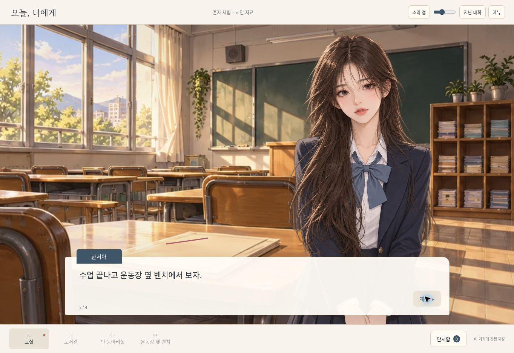

# 대화 인물 표시 수정 — 2026-10-21

기존 4인 표지의 좁은 세로 패널을 대화용 인물로 재사용하고 둥근 모서리로 잘라, 어깨가 잘리고 머리 위에 밝은 배경 조각이 남았다. 표지는 유지하고 대화용 이미지를 네 인물 각각의 투명 상반신 스프라이트로 교체했다.

- PNG 생성 결과의 알파를 보존해 800×1200 WebP로 인코딩했다. 네 파일 합계 약 441 KiB다.
- ``의 원래 2:3 비율과 `object-fit: contain`을 사용한다. 타원형 모서리·박스 발광·하단 마스크를 제거했다.
- 모바일 대화 장면에서는 장소 배경이 화면을 채운다. 높이가 낮은 가로 화면에서는 대화창을 왼쪽으로 옮겨 인물의 얼굴을 가리지 않는다.
- 실제 게임의 첫 여주·남주 대사를 브라우저에서 확인했다. 1280×720 노트북, 390×844 세로와 844×390 가로 iframe 뷰포트를 확인했고 모바일 본문 가로·세로 스크롤은 없었다. 실제 휴대폰 하드웨어 검사는 아니다.
- 네 인물 모두 별도 색 배경 위에서 머리와 어깨 윤곽·투명을 확인했다. JavaScript 구문 검사와 diff 공백 검사를 통과했다. 네트워크·서버·퍼즐 상태 로직은 이번 수정 대상에 포함되지 않는다.

## 이미지 파일과 제작 지시

제작 도구: 내장 image_gen. 편집 참조는 이 프로젝트에서 생성한 `assets/cast-v1.webp`의 네 인물이다. 각 인물별로 한 번씩 생성했으며 `transparent_background: true`를 사용했다.

### yunjae

저장 파일: `public/labs/first-love/assets/yunjae-v2.webp`

최종 프롬프트:

Use case: identity-preserve. Asset type: transparent standing character sprite for a Korean school romance visual novel. Input image 1 is the existing cast reference sheet: preserve the chosen person's recognizable face, hair color, clothing palette and delicate semi-realistic Korean romance webtoon linework and soft painted shading. Create only ONE person, isolated on a genuinely transparent alpha background. Composition: portrait canvas, entire head and all hair visible with clear space above, complete shoulders and both upper arms visible with generous transparent space left and right, natural anatomically proportionate neck and torso, framed from head to upper thighs. Upright natural standing posture, face toward viewer, head almost level, arms relaxed near body. Soft warm daylight, no hard rim light. The sprite will stand in a classroom above a dialogue box. Do not include room, oval mask, card, frame, border, white outline, vignette, floor, cast shadow, halo, backdrop, text, logos or other people. Do not stretch face or neck; do not clip shoulders or hands. School-appropriate neat uniform, fully clothed. Choose the FIRST person, 서윤재: handsome black-haired boy with gently tousled dark hair, warm brown eyes, restrained soft expression, dark navy school blazer, white shirt and muted blue-gray tie. Preserve his facial identity. Calm, slightly shy eye contact. Hands relaxed at his sides.

### seoa

저장 파일: `public/labs/first-love/assets/seoa-v2.webp`

최종 프롬프트:

Use case: identity-preserve. Asset type: transparent standing character sprite for a Korean school romance visual novel. Input image 1 is the existing cast reference sheet: preserve the chosen person's recognizable face, hair color, clothing palette and delicate semi-realistic Korean romance webtoon linework and soft painted shading. Create only ONE person, isolated on a genuinely transparent alpha background. Composition: portrait canvas, entire head and all hair visible with clear space above, complete shoulders and both upper arms visible with generous transparent space left and right, natural anatomically proportionate neck and torso, framed from head to upper thighs. Upright natural standing posture, face toward viewer, head almost level, arms relaxed near body. Soft warm daylight, no hard rim light. The sprite will stand in a classroom above a dialogue box. Do not include room, oval mask, card, frame, border, white outline, vignette, floor, cast shadow, halo, backdrop, text, logos or other people. Do not stretch face or neck; do not clip shoulders or hands. School-appropriate neat uniform, fully clothed. Choose the SECOND person, 한서아: beautiful girl with long dark brown flowing hair, brown eyes, soft neutral and attentive expression, navy school blazer, white shirt with muted blue-gray ribbon bow, pleated navy school skirt. Preserve her facial identity. Relaxed friendly eye contact. Hands gently resting together in front of her waist, both hands anatomically clear. No extreme head tilt.

### doha

저장 파일: `public/labs/first-love/assets/doha-v2.webp`

최종 프롬프트:

Use case: identity-preserve. Asset type: transparent standing character sprite for a Korean school romance visual novel. Input image 1 is the existing cast reference sheet: preserve the chosen person's recognizable face, hair color, clothing palette and delicate semi-realistic Korean romance webtoon linework and soft painted shading. Create only ONE person, isolated on a genuinely transparent alpha background. Composition: portrait canvas, entire head and all hair visible with clear space above, complete shoulders and both upper arms visible with generous transparent space left and right, natural anatomically proportionate neck and torso, framed from head to upper thighs. Upright natural standing posture, face toward viewer, head almost level, arms relaxed near body. Soft warm daylight, no hard rim light. The sprite will stand in a classroom above a dialogue box. Do not include room, oval mask, card, frame, border, white outline, vignette, floor, cast shadow, halo, backdrop, text, logos or other people. Do not stretch face or neck; do not clip shoulders or hands. School-appropriate neat uniform, fully clothed. Choose the THIRD person, 강도하: handsome boy with tousled warm light-brown hair, brown eyes, cheerful easy smile, white shirt with neatly rolled sleeves, dark navy sweater vest and muted blue-gray loosely knotted tie. Preserve his facial identity. Standing upright, not leaning on a hand or on a table; arms relaxed at sides.

### eunseo

저장 파일: `public/labs/first-love/assets/eunseo-v2.webp`

최종 프롬프트:

Use case: identity-preserve. Asset type: transparent standing character sprite for a Korean school romance visual novel. Input image 1 is the existing cast reference sheet: preserve the chosen person's recognizable face, hair color, clothing palette and delicate semi-realistic Korean romance webtoon linework and soft painted shading. Create only ONE person, isolated on a genuinely transparent alpha background. Composition: portrait canvas, entire head and all hair visible with clear space above, complete shoulders and both upper arms visible with generous transparent space left and right, natural anatomically proportionate neck and torso, framed from head to upper thighs. Upright natural standing posture, face toward viewer, head almost level, arms relaxed near body. Soft warm daylight, no hard rim light. The sprite will stand in a classroom above a dialogue box. Do not include room, oval mask, card, frame, border, white outline, vignette, floor, cast shadow, halo, backdrop, text, logos or other people. Do not stretch face or neck; do not clip shoulders or hands. School-appropriate neat uniform, fully clothed. Choose the FOURTH person, 차은서: beautiful girl with a dark chin-length bob, brown eyes and a small confident knowing smile, navy cardigan, white school shirt, muted blue-gray ribbon bow and navy pleated school skirt. Preserve her facial identity. Standing upright, head nearly level, hands naturally resting in front at waist. No leaning face on a hand.

