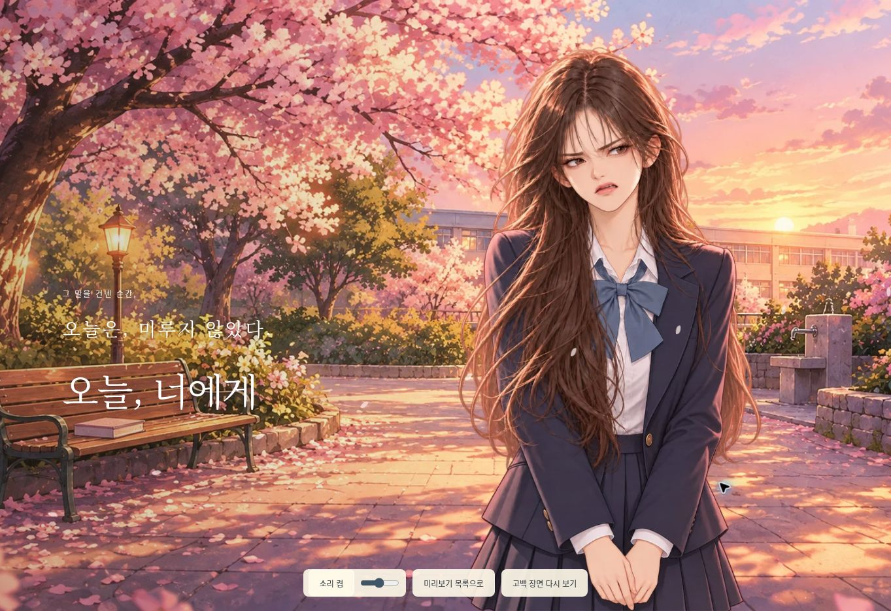

# 부정 엔딩 표정 강화 — 2026-10-21

- 요청: 여주 얼굴이 더 강하게 질색하는 표정으로 보이도록 수정.
- `ending-disgust-v3.webp`를 편집 대상으로 내장 imagegen을 사용했다. 기존 인물·머리·교복·손과 몸 자세를 유지하고 눈썹, 눈매, 코, 입의 혐오/거부 표정을 강화했다.
- 최종 게임 에셋: `public/labs/first-love/assets/ending-disgust-v4.webp` (800×1200, 투명 WebP). PNG의 실제 알파 채널을 유지하고 Sharp로 크기·포맷만 변환했다.
- 부정 엔딩만 v4 에셋을 사용한다. 미소/당황 에셋, 0~10 / 11~29 / 30회 이상 경계, 대화 및 게임 진행 로직은 변경하지 않았다.

## 최종 편집 프롬프트

```text
Use case: identity-preserve.
Asset type: transparent character sprite for an existing Korean school-romance visual novel, negative ending.
Input image 1 is the EDIT TARGET, not merely a style reference. Edit ONLY this girl's facial expression. Preserve her exact recognizable beautiful face, facial proportions, age, long brown hair, head size and position, entire body, pose with hands together, navy blazer, white shirt, navy bow, pleated skirt, lighting, coloring, painterly anime/webtoon rendering, framing, and silhouette.
Primary request: change her currently mildly troubled face into an unmistakably STRONG expression of DISGUST / REVULSION / CONTEMPT (Korean '극혐', '으, 진짜 싫어'). It must read clearly even as a small in-game face. She is visibly repulsed by what she has just heard: sharply knitted lowered brows, upper eyelids lowered and narrowed judgmental eyes with a sideways disgusted glare, clearly scrunched nose with a small crease at the bridge, upper lip raised in a sneer, asymmetrically pulled and strongly downturned mouth corners, slight lower-lip tension. Coordinate ALL the facial features to make rejection and revulsion unmistakable, not sad, worried, embarrassed, bashful, surprised, or coy. Remove romantic cheek blush. Keep her attractive and anatomically convincing; the expression is strong and readable but not a grotesque caricature. Mouth slightly parted in a disgusted grimace without shouting or exaggerated teeth. No tears, no hearts, no symbols, no added effects, no text, no other objects.
Keep the same portrait composition and all non-face pixels as close as possible to the edit target. Genuine transparent alpha background, no scenery, no solid background, no baked checkerboard. One complete single sprite, crown of hair and hands fully visible.
```


## 확인

- `node --check public/labs/first-love/app.mjs`와 `git diff --check` 통과.
- 실제 브라우저의 교사 준비 → 극혐 미리보기에서 새 이미지 로딩, 투명 배경 합성, 표정과 잘림 여부를 확인했다.
- 아래는 수정된 게임 화면이다.


