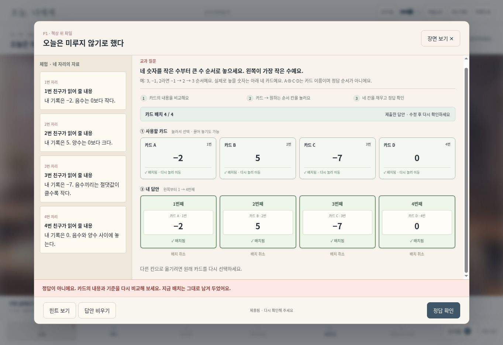
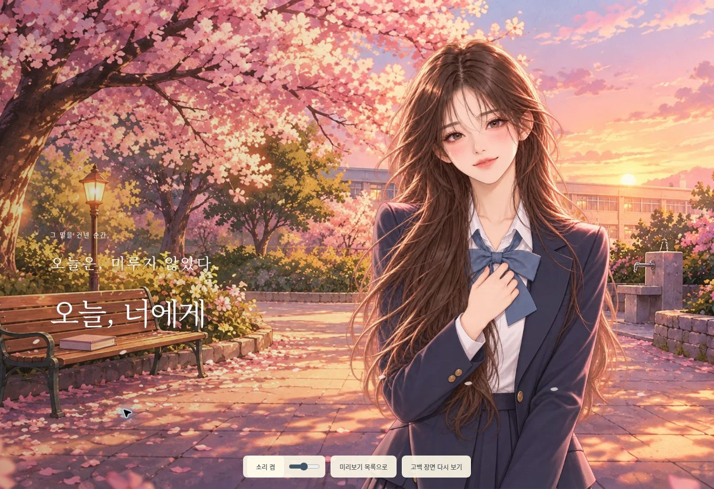

# 오늘, 너에게 — 탐색·문제 조작·로맨스 v3

2026-10-21.

## 바뀐 동작

- 교실·복도·도서관·동아리실·벚꽃길·벚꽃나무 아래의 개별 16:9 배경을 사용한다. 탐색 시 그림 전체를 표시하고 같은 좌표계에 사물 버튼을 놓는다. 이전의 떠 있는 CSS 파일 소품은 렌더링하지 않는다.
- 각 탐색 장소에 여섯 가지 사물 버튼과 관찰 기록을 제공한다. P5·P8은 복도에서 진행한다. 이전 양식의 두 단계 `club` 값만 `corridor`로 정규화해 기존 수업 자료를 계속 읽는다.
- 주연 서윤재·한서아, 친구 강도하·차시우 구성. 한서아만 여성이다. 커버는 각각의 투명 스프라이트를 조합하며, 차시우와 엔딩 표정 세 장을 새로 생성했다.
- 배치한 칸에 카드 내용·그림·담당을 다시 표시한다. 비공개 카드는 배치 뒤에도 내용을 숨긴다. 초록 테두리와 배치 개수, 배치 취소, 제출 전/제출됨을 구분한다.
- 미완성·오답 안내를 네이티브 dialog 안의 고정 영역에 표시한다. 잘못된 답은 그대로 남아 수정할 수 있다. 같은 답 반복 제출의 중복 집계 방지를 유지한다.
- 교과 질문, 예시·기준, 세 단계 조작 안내를 분리한다. 시연 문항과 단계별 힌트, 교사용 작성 프롬프트, 여섯 시트 엑셀 양식을 함께 갱신했다.
- 마음노트의 여섯 종이 페이지, 자유 탐색의 짧은 추억, 서아의 선택형 답장, 친구들의 응원, 벚꽃길 이동과 고백 전 침묵으로 감정을 쌓는다. 이 선택들은 정답·오답·엔딩 판정에 영향을 주지 않는 이야기 선택이다.
- 음악은 외부 음원 없이 새로 구성한 피아노 선율과 아르페지오, 잔향, 저음과 지속 화음으로 재생한다. 봄날/친구들의 준비/저녁/엔딩으로 편곡을 바꾸고 고백 직전 음악을 낮춘 뒤 두 번의 심장 소리를 낸다. 음소거·볼륨은 유지한다.
- 고백 직후 표정으로 끝나는 기존 결말과 0~10 / 11~29 / 30회 이상 경계, 역할별 단서 공개, 수업별 상태 저장을 유지한다.

## 검증

- `node --test tests/first-love.test.cjs tests/first-love-client.test.cjs`: 10개 통과. 1~4인 전 단계 진행, 경계/중복 집계/재접속, 30 논리 클라이언트, 엑셀 왕복, 배치 UI 비공개 정보, 구양식 장소 호환 포함. 실제 학교 Wi-Fi 또는 물리 기기 30대 부하 측정은 아니다.
- 실제 브라우저에서 P1 빈칸 제출, 완성 오답, 내용이 보이는 배치, 정답 재배치 후 진행을 확인했다. P9의 새 그림 확대 및 세 사물 확인, P10의 회전·여섯 칸 이동·H 자료함 제출을 통해 편지를 얻고 벚꽃길로 넘어가는 흐름을 확인했다.
- 도서관·복도 이동, 사물 탐색, 새 엔딩, 벚꽃길에서 고백으로 이어지는 두 인물 장면을 확인했다. 모바일 390×844와 가로 844×390을 확인하며 대화 배경 채움과 겹침을 조정했다.
- 교과 엑셀은 Artifact Tool로 기존 양식을 가져와 변경된 값 110개를 갱신했다. 원래 여섯 시트·제목·입력색·틀 고정을 유지하고 긴 문항의 행 높이만 맞췄다. 변경된 퍼즐·자료·모둠단서 영역을 렌더링해 확인하고, 서버 업로드 파서 결과가 SAMPLE과 일치함을 확인했다.
- 교과의 의미·난이도는 업로드 구조 검사만으로 보장되지 않는다. 작성 프롬프트에 명확한 질문·교과 기준·짧은 예·검산 규칙을 추가하고 교사 미리보기에서 실제 조작과 내용을 확인하도록 했다.

## 새 캐릭터 생성

내장 imagegen을 사용했다. 기존 `seoa-v2.webp`를 화풍·동일 인물 참조로 사용했으며 모두 `transparent_background: true`다. PNG의 실제 알파를 확인한 뒤 Sharp로 높이 1200px, WebP quality 84, alphaQuality 100으로 변환했다. 이미지 내용을 코드로 그리거나 수정하지 않았다. 배경 프롬프트와 좌표는 `location-art-v3.md`에 있다.

### siwoo

```text
Create a single new male character sprite for a polished Korean school first-love visual novel. The reference is ONLY for matching the illustration quality, delicate linework and school uniform palette, not for the gender or face. Character: Cha Siwoo, a very handsome Korean male high-school senior, unmistakably male face with softly angular jaw and masculine brows, tidy dark ash-brown side-parted hair, expressive kind dark eyes, slim straight posture, composed caring smile, navy school blazer, white shirt, loosely neat charcoal tie, dark trousers, carrying a small plain closed notebook low by his side. Youthful and age-appropriate; charming Korean romance webtoon aesthetics with painterly hair detail, natural facial anatomy, no uncanny photorealism. One character only, head to mid-thigh, facing slightly left, both shoulders and whole hair silhouette completely inside frame, relaxed natural hands, no cropping of head. TRUE transparent background. No text, no frame, no scenery, no secondary face, no floating props. Portrait 2:3.
```

### ending_smile

```text
Edit the provided heroine into a new high-quality expression sprite for the final confession scene of the same Korean school romance visual novel. Preserve this EXACT character's recognizable face, long softly wavy brown hair, navy school blazer, white shirt and large slate-blue ribbon, and matching delicate painterly anime linework. A quietly delighted, very romantic reaction: her eyes soften and meet the viewer, a small involuntary closed-mouth smile grows, cheeks subtly flushed, eyebrows relaxed, one hand gently resting over her own chest. The feeling is a long-awaited confession, tender and emotionally convincing. One beautiful female student only, age-appropriate, fully clothed. Portrait 2:3, from above full head to waist, complete hair and shoulders inside frame with breathing room, camera at eye level. Soft warm pink sunset rim light, believable anatomy, polished romance game character art, clear expressive eyes. TRUE transparent background with clean silhouette. No background, no petals, no hearts, no written words, no frame, no other character. The expression must remain readable at small screen sizes.
```

### ending_surprise

```text
Edit the provided heroine into a new high-quality expression sprite for the final confession scene of the same Korean school romance visual novel. Preserve this EXACT character's recognizable face, long softly wavy brown hair, navy school blazer, white shirt and large slate-blue ribbon, and matching delicate painterly anime linework. A surprised, uncertain reaction: eyes slightly widened, lips gently parted as if catching a breath, mild blush, eyebrows lifted naturally, shoulders still. Emotion is surprised and flustered, NOT a smile and not dislike. One beautiful female student only, age-appropriate, fully clothed. Portrait 2:3, from above full head to waist, complete hair and shoulders inside frame with breathing room, camera at eye level. Soft warm pink sunset rim light, believable anatomy, polished romance game character art, clear expressive eyes. TRUE transparent background with clean silhouette. No background, no petals, no hearts, no written words, no frame, no other character. The expression must remain readable at small screen sizes.
```

### ending_disgust

```text
Edit the provided heroine into a new high-quality expression sprite for the final confession scene of the same Korean school romance visual novel. Preserve this EXACT character's recognizable face, long softly wavy brown hair, navy school blazer, white shirt and large slate-blue ribbon, and matching delicate painterly anime linework. An unmistakably uncomfortable, displeased reaction: subtle frown, brows pulled inward, lips pressed with corners slightly lowered, eyes look slightly away, shoulders subtly withdraw. Natural and restrained, no grotesque caricature, no tears, no smiling. One beautiful female student only, age-appropriate, fully clothed. Portrait 2:3, from above full head to waist, complete hair and shoulders inside frame with breathing room, camera at eye level. Soft warm pink sunset rim light, believable anatomy, polished romance game character art, clear expressive eyes. TRUE transparent background with clean silhouette. No background, no petals, no hearts, no written words, no frame, no other character. The expression must remain readable at small screen sizes.
```


## 운영 배포 확인

- 변경 커밋: `e43e0c171fb3248f9a98dd4cdf4eb6a9f6469ca7`.
- Vercel 배포: `dpl_8ZxjrtBGbT8FZw7uFZnEn5pALLpA`, production `READY`, `scilab-platform.vercel.app` 연결 확인.
- 실제 공개 주소의 P1에서 네 장을 잘못 놓고 제출: 카드 내용·배치 4/4·제출됨·지속 오답 안내를 확인했다.
- 실제 공개 주소의 새 엔딩에서 투명 표정 이미지, 벚꽃 배경, 소리/볼륨, 다시 보기 버튼을 확인했다.
- 운영 DB·홈페이지 목록·삭제 표식에는 변경하지 않았다. 검증은 교사 미리보기에서 진행했다.




